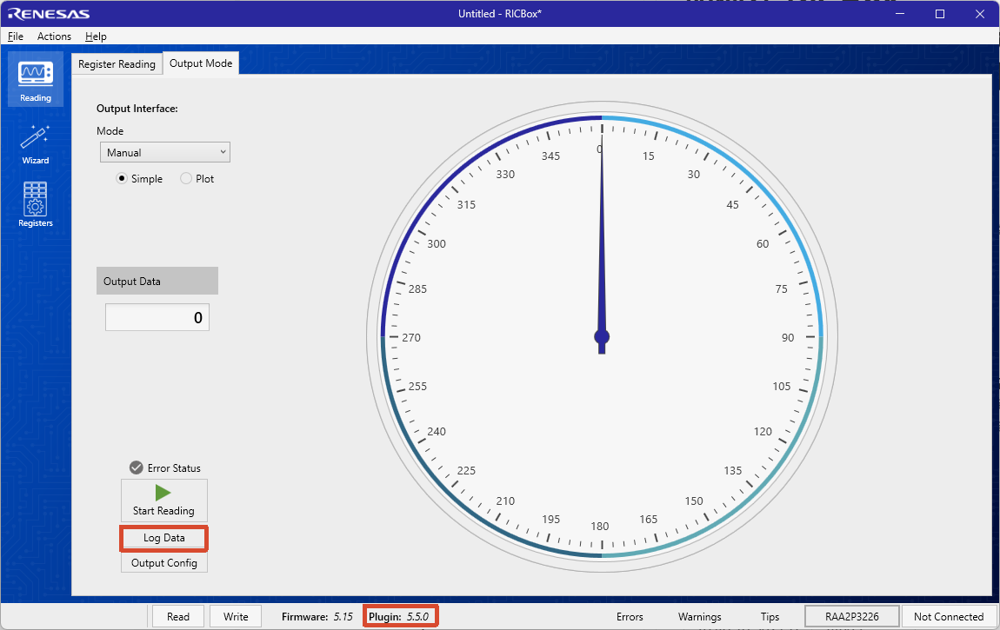

<!--
Internal Notes:
N.A.
-->

# 如何在 RICBox RAA2P3xxx-4xxx 中 为 Log Data的数据添加时间戳

## ❔问题

如何在 RICBox RAA2P3xxx-4xxx 中为 Log Data的数据添加时间戳

---

## 👌答案

请将 **RAA2P3xxx-4xxx Plugin** 升级至 **5.5.0 或更高版本**。在早期版本中，Log Data 导出的数据未包含时间戳信息；从 5.5.0 开始，Log Data 功能已默认添加时间戳。

包含有时间戳的Log Data：
```csv
TIME;Output Data
16:46:16.398572;14803
16:46:16.449868;14803
16:46:16.502151;14803
16:46:16.552158;14803
16:46:16.601235;14803
16:46:16.651850;14803
16:46:16.702478;14803
16:46:16.752598;14802
16:46:16.804222;14803
16:46:16.854433;14804
16:46:16.903986;14802
16:46:16.953318;14803
16:46:17.003186;14803
```



*图 1. RAA2P3xxx-4xxx Plugin 5.5.0 版本的截图。*