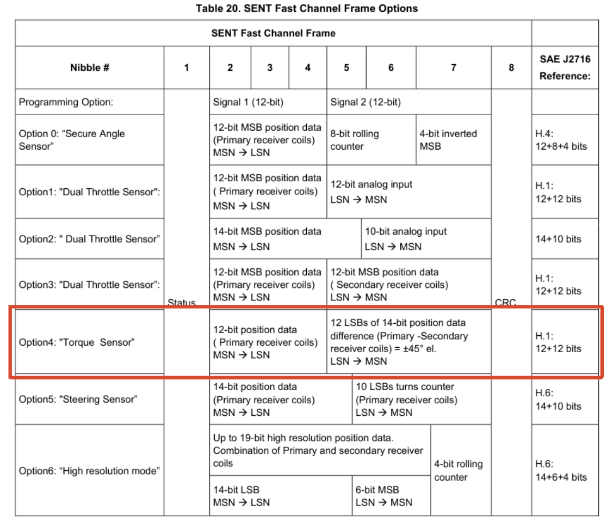

<!--
Internal Notes:
N.A.
-->

# RAA2P4520/RAA2P4524 是否可以直接输出扭矩值？

## ❔问题

RAA2P4520 或 RAA2P4524 是否可以直接输出扭矩值？

---

## 👌答案

不能。RAA2P4520 和 RAA2P4524 无法直接输出以类似于 N·m 为单位的扭矩值。对于扭矩传感器应用，芯片在其 SENT 通讯接口中提供了专用的 **Torque Sensor Option（Option 4）**。在该模式下，芯片可以通过 SENT 接口输出主线圈（Primary Receiver Coils）和副线圈（Secondary Receiver Coils）之间的角度差信息。

*图 1. 芯片规格书中关于 SENT Torque Sensor Option（Option 4） 的说明。*

在典型的扭矩传感器应用中，施加的扭矩会导致扭杆产生微小的扭转变形，从而形成主、副接收线圈之间的角度差。RAA2P4520/RAA2P4524 负责测量并输出该角度差信息，而实际的扭矩计算则由 MCU 或 ECU 完成。